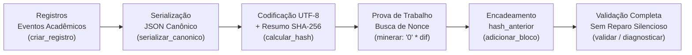
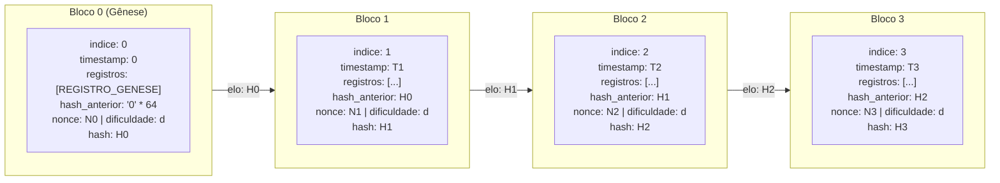

# Projeto Bônus — Blockchain Didática (Introdução à Criptografia)


-brightgreen.svg)

Implementação completa, documentada e testada de uma **blockchain local didática** em Python 3 para o registro de eventos acadêmicos fictícios (matrículas, conclusões de disciplinas, atas de defesa e emissão de certificados), desenvolvida como **Projeto Bônus** da disciplina de **Introdução à Criptografia**.

> **⚠️ Limite de Segurança e Aviso Educacional:**  
> Este projeto é **exclusivamente educacional e local**. Não cria criptomoeda, carteira, ativo financeiro ou rede P2P segura. Uma lista local de blocos em memória ou arquivo JSON não oferece consenso distribuído nem imutabilidade absoluta contra um controlador local único sem uma âncora externa confiável. Utilize apenas **dados e pseudônimos fictícios** (`aluno-017`), pois funções de hash públicas não cifram registros nem anonimizam nomes, documentos ou notas previsíveis.

---

## 📁 Estrutura do Repositório (Entregáveis e Extensões)

```text
projeto-bonus-cripto/
├── blockchain.py            # [Entregável Obrigatório] Núcleo da blockchain, Bloco, PoW e validação
├── demo.py                  # [Entregável Obrigatório] As 5 situações da demonstração e ataque controlado
├── test_blockchain.py       # [Entregável Obrigatório] 18 testes automatizados (12 requisitos + extensões)
├── README.md                # [Entregável Obrigatório] Documentação completa, arquitetura e instruções
├── relatorio_tecnico.docx   # [Relatório Editável] Relatório técnico formatado em Word (.docx) para edição
├── relatorio_tecnico.pdf    # [Entregável Obrigatório] Relatório técnico (3 páginas diagramadas em PDF)
├── extensoes.py             # [Seção 9] Merkle Tree, Ed25519, Persistência JSON, 2 Nós e Estatísticas
├── cli.py                   # [Seção 9] Interface de Linha de Comando (CLI) para gerenciar a cadeia
├── codigo_inicial/          # [Etapa 0] Esqueleto inicial com TODOs para registro metodológico da Etapa 0
├── requirements.txt         # Dependência opcional (cryptography, apenas para a extensão Ed25519)
└── .gitignore               # Configuração de arquivos ignorados pelo Git
```

---

## 🏗️ Arquitetura e Modelo de Dados (Rubrica — Critério 1)

### Diagrama de Fluxo da Arquitetura



### Encadeamento Criptográfico dos Blocos



### Campos Obrigatórios de um `Bloco`

| Campo | Tipo | Finalidade Criptográfica e Estrutural | Entra no Hash? |
| :--- | :---: | :--- | :---: |
| `indice` | `int` | Posição sequencial esperada do bloco na cadeia (`0, 1, 2, ...`). Impede reordenação ou omissão de blocos. | **Sim** |
| `timestamp` | `int` | Instante associado à criação do bloco em segundos Unix (`0` no gênese). Permite injeção determinística nos testes. | **Sim** |
| `registros` | `list[dict[str, str]]` | Lista de eventos acadêmicos fictícios (`tipo`, `participante`, `descricao`), copiada profundamente (`deepcopy`). | **Sim** |
| `hash_anterior` | `str` | Hash SHA-256 de 64 dígitos hexadecimais armazenado no bloco precedente (`"0" * 64` no gênese). É o elo da cadeia. | **Sim** |
| `nonce` | `int` | Contador público inteiro (`0, 1, 2, ...`) ajustado durante a mineração até satisfazer a dificuldade. | **Sim** |
| `dificuldade` | `int` | Quantidade de zeros hexadecimais exigidos no início do hash (`1` a `6`). | **Sim** |
| `hash` | `str` | Resumo SHA-256 (64 caracteres hexadecimais) calculado sobre a serialização canônica dos 6 campos acima. | **Não** *(é a saída)* |

---

## 🧰 Explicação das Bibliotecas, Funções e Métodos (Seção 2)

O núcleo do projeto (`blockchain.py`, `demo.py` e os testes principais em `test_blockchain.py`) utiliza **exclusivamente a biblioteca padrão do Python 3.10+**:

* **`dataclasses.dataclass`**: Cria automaticamente `__init__`, `__repr__` e `__eq__` para a classe `Bloco`, permitindo validação pós-inicialização em `__post_init__`.
* **`json.dumps`**: Converte dicionários e listas em texto JSON. Com `sort_keys=True`, `separators=(",", ":")`, `ensure_ascii=False` e `allow_nan=False`, garante uma **serialização canônica determinística** (chaves ordenadas, sem espaços supérfluos, Unicode preservado e rejeição de `NaN`/`Infinity`).
* **`str.encode("utf-8")`**: Codifica o texto JSON canônico em `bytes` UTF-8, formato exigido pela função criptográfica SHA-256.
* **`hashlib.sha256` e `.hexdigest()`**: Calcula o resumo criptográfico SHA-256 de 256 bits e o retorna como string de 64 dígitos hexadecimais.
* **`time.time`**: Obtém o instante atual em segundos desde a Época Unix (convertido para `int`). O método `adicionar_bloco` também aceita um `timestamp` explícito para reprodutibilidade nos testes.
* **`time.perf_counter`**: Relógio monotônico de alta resolução usado para medir a duração exata da mineração na comparação entre dificuldades.
* **`str.startswith("0" * dificuldade)`**: Verifica se o resumo hexadecimal cumpre a condição da prova de trabalho didática.
* **`copy.deepcopy`**: Cria cópias profundas das listas e dicionários de registros recebidos do chamador, impedindo que mutações externas posteriores alterem silenciosamente um bloco já minerado.
* **`typing.Any`**: Fornece anotações de tipo explícitas para funções que validam entradas genéricas.
* **`unittest`**: Framework de testes automatizados da biblioteca padrão usado para verificar todos os requisitos positivos e negativos.
* **Por que `secrets` não é usado no núcleo?** O módulo `secrets` gera números aleatórios criptograficamente seguros para segredos (chaves, tokens). Na prova de trabalho (PoW), o `nonce` não é um segredo: é um contador público determinístico (`0, 1, 2, 3...`) incrementado até encontrar um hash válido.

---

## 🔬 Registro da Etapa 0 — Hipóteses e Mapeamento de TODOs

Na **Etapa 0**, antes da implementação das funções no esqueleto inicial (`codigo_inicial/`), a execução de `python -m unittest -v` falha com `NotImplementedError` nos pontos marcados com `TODO`. A tabela abaixo registra a relação direta entre cada falha inicial, o `TODO` correspondente e a solução implementada:

| Função / Método (`TODO`) | Falha Inicial na Etapa 0 | Hipótese e Solução Implementada |
| :--- | :--- | :--- |
| `serializar_canonico` | Testes de serialização e hash falham com `NotImplementedError`. | Implementar `json.dumps` com `sort_keys=True`, `separators=(",", ":")`, `ensure_ascii=False` e `allow_nan=False`. |
| `criar_registro` | Testes de criação e rejeição de registros vazios/tipos errados falham. | Verificar `isinstance(v, str)`, aplicar `.strip()` e lançar `ValueError` se vazio ou `TypeError` se não for string. |
| `Bloco.conteudo_para_hash` | Cálculo de hash falha por não reunir os campos protegidos. | Retornar dicionário com `indice`, `timestamp`, `registros`, `hash_anterior`, `nonce` e `dificuldade` (excluindo `hash`). |
| `Bloco.calcular_hash` | Cálculo SHA-256 falha. | Encadear `serializar_canonico(self.conteudo_para_hash()).encode("utf-8")` e `hashlib.sha256(...).hexdigest()`. |
| `Bloco.minerar` | Testes de PoW e gênese falham. | Reiniciar `self.nonce = 0` e incrementar até `calcular_hash().startswith("0" * self.dificuldade)`. |
| `Blockchain.__init__` | Criação do bloco gênese e validação de dificuldade falham. | Validar `1 <= dificuldade <= 6` (inteiro), instanciar gênese (`indice=0`, `timestamp=0`, `REGISTRO_GENESE`, `"0"*64`) e minerar. |
| `Blockchain.ultimo_bloco` | Acesso ao topo da cadeia falha. | Retornar `self.blocos[-1]`. |
| `Blockchain.adicionar_bloco` | Inclusão de 3 blocos e proteção contra mutação externa falham. | Exigir `self.validar() == True`, aplicar `copy.deepcopy`, usar `ultimo_bloco.hash`, minerar e anexar. |
| `Blockchain.validar` | Detecção de adulteração de registro, `hash_anterior` e `nonce` falha. | Conferir gênese, índices sequenciais, dificuldades, registros, igualdade `hash == calcular_hash()`, PoW e elos sem reparar a cadeia. |

---

## 🚀 Como Executar o Projeto

### Pré-requisitos
* **Python 3.10 ou superior** (não é necessário instalar nenhum pacote externo para executar `blockchain.py`, `demo.py`, `cli.py` ou os testes obrigatórios de `test_blockchain.py`).
* Caso utilize o gerenciador `uv`, você também pode prefixar qualquer comando com `uv run`.

### 1. Executar a Suíte Completa de Testes Automatizados (`unittest`)

```bash
python -m unittest -v
```
*(Ou com `uv`: `uv run --with cryptography python -m unittest -v` para executar também o teste opcional de assinatura digital Ed25519).*

Todos os **18 testes automatizados** (cobrindo os 12 requisitos obrigatórios da Seção 5 + o fluxo completo de ataque controlado + as 6 extensões opcionais da Seção 9) passam com `OK`.

### 2. Executar a Demonstração Obrigatória (As 5 Situações + Ataque Controlado)

```bash
python demo.py
```
O script `demo.py` executa e imprime detalhadamente:
1. **Etapa 2:** Demonstração do determinismo da serialização canônica (chaves em ordens distintas geram o mesmo JSON) e do efeito avalanche do SHA-256 ao alterar um único caractere (`60h` $\rightarrow$ `61h`).
2. **Situação 1 (Cadeia Original Íntegra):** Cria o bloco gênese e 3 blocos com eventos acadêmicos fictícios (`aluno-017`, `aluno-042`, `aluno-089`) e comprova que `cadeia.validar()` retorna `True`. Salva o hash do Bloco 3 como **âncora externa confiável**.
3. **Situação 2 (Adulteração Direta):** Altera a nota do `aluno-042` no Bloco 1 de `conceito B` para `conceito A+ (ADULTERADO)` sem reminerar. Comprova que `cadeia.validar()` retorna `False` porque o hash armazenado no Bloco 1 diverge do hash recalculado.
4. **Situação 3 (Remineração Isolada do Bloco Adulterado):** Executa `cadeia.blocos[1].minerar()`. Mostra que o Bloco 1 volta a ter PoW válida isoladamente, mas `cadeia.validar()` continua retornando `False` porque o `hash_anterior` do Bloco 2 ainda aponta para o hash antigo do Bloco 1.
5. **Situação 4 (Reconstrução Total pelo Controlador Único):** Atualiza `hash_anterior` e reminera os Blocos 2 e 3 em cascata. Mostra que `cadeia.validar()` volta a retornar `True` localmente, mas que o novo hash do Bloco 3 diverge da **âncora externa confiável**, provando por que PoW e encadeamento local não oferecem imutabilidade absoluta sem cópias independentes e consenso distribuído.
6. **Situação 5 (Comparação Experimental de Dificuldades):** Compara as dificuldades `1`, `2` e `3`, registrando o crescimento exponencial ($16^d$) no número de tentativas e no tempo medido com `time.perf_counter()`.

### 3. Executar a Interface de Linha de Comando (Extensão Opcional — `cli.py`)

```bash
# 1. Inicializar uma nova cadeia persistida em JSON com dificuldade 2
python cli.py init --dificuldade 2

# 2. Inserir novos eventos acadêmicos fictícios
python cli.py inserir --tipo "disciplina" --participante "aluno-017" --descricao "Aprovado em Introducao a Criptografia"
python cli.py inserir --tipo "certificado" --participante "aluno-017" --descricao "Monitoria em Seguranca (40h)"

# 3. Listar todos os blocos com seus hashes e raízes de Merkle
python cli.py listar

# 4. Consultar eventos filtrando por participante ou tipo
python cli.py consultar --participante "aluno-017"

# 5. Validar a integridade do arquivo JSON
python cli.py validar

# 6. Rodar benchmark estatístico do número médio de tentativas por dificuldade
python cli.py benchmark --amostras 8
```

### 4. Relatório Técnico (Seção 6 e 7)

O relatório técnico respondendo detalhadamente às 9 questões obrigatórias da Seção 6 está disponível na raiz do repositório em dois formatos:
* [relatorio_tecnico.docx](relatorio_tecnico.docx) (versão editável em Microsoft Word)
* [relatorio_tecnico.pdf](relatorio_tecnico.pdf) (versão diagramada de 3 páginas pronta para entrega em PDF)

---

## 🎤 Roteiro Sugerido para a Apresentação (6 a 10 minutos)

Para cumprir a exigência de participação de todos os integrantes e realização de uma pequena alteração ao vivo (Seções 5, 7 e 10):

1. **Minutos 0–2 (Modelo de Dados, Serialização Canônica e SHA-256):**
   * Mostrar `serializar_canonico`, `criar_registro` e `Bloco.conteudo_para_hash` em `blockchain.py`.
   * Explicar por que o campo `hash` fica fora de `conteudo_para_hash` e como `sort_keys=True` e `separators=(",", ":")` garantem determinismo.
2. **Minutos 2–4 (Bloco Gênese, Prova de Trabalho e Inclusão de Blocos):**
   * Explicar `Bloco.minerar()`, `Blockchain.__init__()` e `Blockchain.adicionar_bloco()`.
   * Mostrar por que `copy.deepcopy` impede mutação externa silenciosa e por que cada zero hexadecimal adicional multiplica as tentativas por 16 ($2^4 = 16$).
3. **Minutos 4–7 (Execução Ao Vivo de `demo.py` e `test_blockchain.py`):**
   * Executar `python demo.py` e percorrer as Situações 1 a 5 no terminal.
   * Executar `python -m unittest -v` mostrando os 18 testes passando.
   * **Pequena alteração ao vivo (Seção 10):** Alterar uma descrição ou dificuldade em `demo.py` ou criar um teste rápido em `test_blockchain.py` e rodar novamente para demonstrar domínio completo do código.
4. **Minutos 7–9 (Análise Crítica e Limites de Segurança):**
   * Explicar por que a Situação 4 reconstrói a cadeia local, o papel da **âncora externa confiável**, a diferença entre integridade e confidencialidade (por que hash não anonimiza dados previsíveis) e por que um banco de dados assinado digitalmente é mais simples para uma instituição única.

---

## 📜 Declaração de Fontes, Ferramentas e Integridade Acadêmica (Seção 10)

Em conformidade com as diretrizes de integridade acadêmica da Seção 10 do caderno do projeto:

1. **Fontes e Referências Técnicas:**
   * Caderno de instruções do *Projeto Bônus: Construa uma blockchain didática* — Disciplina de Introdução à Criptografia.
   * Documentação oficial da Biblioteca Padrão do Python 3 (`dataclasses`, `json`, `hashlib`, `time`, `copy`, `typing`, `unittest`, `argparse`).
   * FIPS PUB 180-4 (*Secure Hash Standard — SHA-256*) e RFC 8259 (*The JavaScript Object Notation Data Interchange Format*).
   * Documentação da biblioteca `cryptography` (`cryptography.hazmat.primitives.asymmetric.ed25519`), utilizada exclusivamente na extensão opcional de assinatura digital Ed25519 da Seção 9.
2. **Declaração de Uso de Inteligência Artificial:**
   * Ferramentas de assistência por inteligência artificial (Antigravity / Gemini) foram utilizadas como apoio na estruturação da documentação, revisão de tipagem estática, geração de casos de teste automatizados e diagramação do relatório em PDF. Todo o código-fonte, a lógica de validação criptográfica, os experimentos de dificuldade e as respostas conceituais foram verificados, testados e validados para garantir compreensão integral de cada linha entregue.
3. **Segurança dos Dados:**
   * Todos os registros, identificadores (`aluno-017`, `aluno-042`, `aluno-089`, `sistema-000`) e eventos utilizados no código, nos testes e na demonstração são **100% fictícios**. Nenhuma biblioteca pronta de blockchain foi utilizada.
